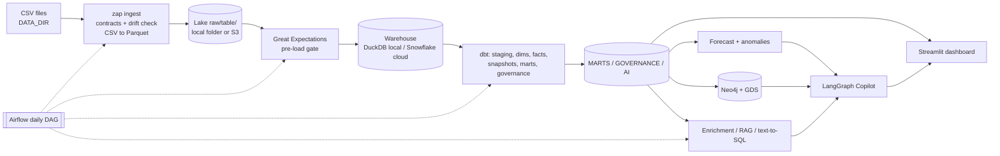

# PLAN: Zomato AI Data Platform

Status: **APPROVED** on 2026-10-29. All decisions D1–D8 accepted as recommended:

| Decision | Outcome |
|---|---|
| D1 | You download `users.csv`, `menu.csv` and `order_items.csv` into `data/` |
| D2 | B3 becomes a signal audit plus popularity and MF baselines (no GNN) |
| D3 | B7 cut |
| D4 | Repo at `C:\Users\dheer\dev\zomato-ai-data-platform`; `DATA_DIR` points at the OneDrive data folder |
| D5 | Dataset labelled synthetic; synthetic injections used only for testing detectors |
| D6 | make, Terraform and AWS CLI installed via winget when needed (make done in M0) |
| D7 | OpenAI confirmed |
| D8 | You create the GitHub repo; I never push without asking |

## 1. Goal and ground rules

Build a portfolio project that rebuilds the reference pipeline as my own work
(CSV → lake → warehouse → dbt → Airflow → AI → dashboard), then adds the JD gaps:
governance, knowledge graph, time series, evaluated GenAI, an agent, and cloud and
engineering practice.

Rules that apply everywhere:

- Every number in `docs/METRICS.md`, README and `RESUME_BULLETS.md` comes from a
  machine-written artifact of a real run. Anything not run is shown as **"not run"**.
  Anything computed on sampled or synthetic data is labelled as such.
- Zero-cost local mode first (DuckDB). Cloud (S3, Snowflake, OpenAI) only after you
  approve each step that costs money.
- I never fake credentials or console actions; I tell you exactly what to click.
- Each milestone runs end-to-end, has tests, updates `docs/LEARNING_NOTES.md`, and ends in a commit.

## 2. What I took from the reference repo, and what I will do differently

The reference ([darshilparmar/zomato-ai-data-engineering-end-to-end-project](https://github.com/darshilparmar/zomato-ai-data-engineering-end-to-end-project))
has: 5 Snowflake setup scripts, 7 staging views, dims and incremental facts (MERGE),
4 marts, a 4-task `@daily` DAG, and 3 OpenAI scripts (enrichment, RAG, text-to-SQL).

| Area | Reference | This project |
|---|---|---|
| Incremental facts | `order_timestamp > max(...)`, no lookback | MERGE with a 3-day lookback window and a reconciliation test; full-refresh vs incremental runtime measured |
| Airflow | no retries, timeouts, SLA, or idempotency; dbt and Python share no env | retries with backoff, `execution_timeout`, failure callback, SLA via Deadline Alerts (see risk R9), partition-level idempotent loads, a rerun test |
| Raw loads | `ON_ERROR='CONTINUE'` silently drops rows on some tables | schema contracts, drift detection, GX gate, bad records quarantined and **counted** |
| Enrichment | no validation, retries, or cost log; `SAMPLE_N=5` | Pydantic-validated structured output, retry and re-ask, token and cost log, disk cache, budget cap, dedupe by text |
| RAG | 500 random reviews, brute-force cosine, no eval | Chroma + BM25 + RRF fusion + cross-encoder rerank, metadata filters, a 50+ question golden set, recall@5 and faithfulness before vs after |
| Text-to-SQL | keyword blacklist (bypassable, e.g. `MERGE`, `COPY`), runs as the write role, no eval | `sqlglot` AST guard (single SELECT, table allowlist, no file-reading table functions), read-only connection or role, forced LIMIT, timeout, a 30+ question execution-accuracy eval |
| Extras | none | Neo4j knowledge graph + GDS, forecasting, LangGraph agent, Terraform, CI, tests, data dictionary, PII masking, ADRs |

## 3. Data profile (real numbers, full CSVs, DuckDB, 2026-10-29)

**Files present in `data/`:** `orders.csv` (1.33 GB), `restaurant.csv`, `food.csv`, `reviews.csv`.
**Missing compared with the reference:** `users.csv`, `menu.csv`, `order_items.csv` (see decision D1).

| Fact | Value |
|---|---|
| orders | 10,000,000 rows; 99,969 users; 148,541 restaurants (all match `restaurant.csv`); 2024-01-01 → 2026-06-30 |
| status mix | Delivered 9,150,122 · Cancelled 599,251 · Refunded 250,627 |
| order arithmetic | `sales_amount = subtotal − discount + delivery_fee + gst` holds on every row; no null keys; no duplicate ids |
| volume trend | 190,767 orders (Jan 2024) → 465,587 (Jun 2026); Saturday 1.89M vs Wednesday 1.18M; peaks at 13:00 and 20:00 |
| delivery time | p50 = 31 min and p90 = 45 min **in every hour of the day and every top city** |
| cancel rate | ≈ 6% in every top city; spread across restaurants looks like random noise |
| user behaviour | median user: 60 orders, 60 distinct restaurants, **55 distinct cities**; repeat user-restaurant pairs = 19,778 of 9,980,043 |
| popularity | median 40 orders/restaurant, max 501; top 1% of restaurants = 6.3% of orders; corr(orders, rating) = 0.14 |
| reviews | 300,000 rows but **only 294 distinct comment strings** (templated) |
| review integrity | `review.user_id` ≠ the order's user on 299,998 rows; `review.restaurant_id` ≠ the order's restaurant on 300,000; 172,401 reviews dated **before** their order; 25,380 reviews on non-delivered orders |
| restaurants | 148,541 rows; 87,014 with rating `--`; cost as text (`₹ 200`); "city" mixes `Area,City` (821 values); links point to **swiggy.com** |
| food | 371,561 rows; 1 null veg flag |

**What this means (honest reading):**

1. The fact tables are **synthetic** and mostly uniform. The dimensions look scraped from
   Swiggy. I will call it "Zomato-style food-delivery data" and say this in the README.
2. **Real signal:** growth trend, weekly and hourly seasonality, payment mix, a mild
   popularity skew, and many genuine data-quality defects. Forecasting (B4) and governance (B1) are well-founded.
3. **Weak or no signal:** delivery SLA by city or hour (flat), cancellations (uniform), and
   user-restaurant preference (users order everywhere, almost never repeat).
   - A GNN recommender (B3) will not beat popularity on this data. Any number it produced would be noise.
   - The "SLA breach by city/hour" recommendation the brief asks for has nothing to find.
     The business case will say so and pivot to the signals that are real (capacity
     planning from demand peaks, data-trust issues).
4. **Reviews are templated:** 294 unique texts. Enrichment can dedupe and make 294 LLM
   calls, not 300K. That gives a real cost result, but RAG retrieval will be easier than
   on real text. I will state that next to every RAG number.
5. The review inconsistencies (wrong user or restaurant, review before order) are a real
   data-quality story: they get caught and quarantined, and the counts are logged.

## 4. Architecture



There are two interchangeable targets, selected by `TARGET=duckdb|snowflake`:

- **Local:** lake = `./lake/raw/<table>/`, warehouse = DuckDB file, $0. Used by CI on a tiny synthetic fixture.
- **Cloud:** lake = `s3://<bucket>/raw/<table>/`, warehouse = Snowflake (COPY INTO via storage integration).

**Lake layout:** dimensions are one Parquet file per table. Facts (orders, order_items,
reviews) are Hive-partitioned by `order_date=YYYY-MM-DD`, to mimic daily batch arrival.
Every row carries `_batch_id`, `_source_file` and `_loaded_at`.

**Daily simulation:** the source data is static and ends 2026-06-30. The DAG "replays"
one day per logical date: it extracts that day's partition, loads it idempotently
(delete partition, then insert), and runs dbt incrementally. Freshness checks use
`_loaded_at`, not business dates, so they stay meaningful.

**Sample mode:** a deterministic 5% sample by `hash(user_id)` keeps each sampled user's
full history, which the graph and recommender work needs. Forecasting runs on full data
locally, because DuckDB handles 10M rows in seconds and a 5% city-day series is too noisy.

## 5. Stack (exact versions pinned in `uv.lock` at M0)

| Concern | Choice | Why (an ADR records each) |
|---|---|---|
| Python env | uv, Python 3.12, one `pyproject.toml` with dependency groups | fast, reproducible; groups isolate heavy deps |
| Local warehouse | DuckDB + dbt-duckdb | $0, fast on 10M rows, runs in CI |
| Cloud warehouse | Snowflake trial + dbt-snowflake | matches the JD and the reference; separates compute from storage |
| Data quality | dbt tests + dbt_utils + Great Expectations (GX Core 1.x) | GX is the widely known tool; it runs in its own dependency group |
| Orchestration | Airflow 3.1 (Docker, LocalExecutor, trimmed compose) | current major version; LocalExecutor saves about 1.5 GB of RAM compared with Celery |
| Graph | Neo4j 5 Community + GDS plugin (Docker) | native Cypher; GDS gives PageRank, Louvain and node similarity |
| Embeddings + rerank | fastembed (bge-small-en-v1.5, ms-marco-MiniLM cross-encoder), local CPU | free, no PyTorch needed, small disk footprint |
| Vector store / lexical | Chroma (embedded) + bm25s, fused with RRF | no extra server; hybrid retrieval |
| LLM | OpenAI (cheapest current model, configurable) through a thin client | as in your brief; offline replay mode so tests and CI never call the API |
| Agent | LangGraph (`interrupt` for human approval) | explicit state machine, checkpointing, traceable |
| SQL safety | sqlglot | AST parsing instead of keyword blacklists |
| Forecasting | seasonal-naive, statsmodels ETS, LightGBM | Prophet skipped: it brings a cmdstan toolchain that is fragile on Windows |
| Dashboard | Streamlit + Plotly | as in your brief |
| IaC | Terraform (AWS S3 + IAM); Snowflake objects as versioned SQL | small surface; the SQL is easy to read in an interview |
| Quality tooling | ruff, mypy, pytest + pytest-cov (≥80% gate on `src/zap`), pre-commit, gitleaks | as in your brief |
| CI | GitHub Actions (ubuntu): lint, type, test, dbt build on fixture, Docker build | as in your brief |

## 6. Folder structure

```
zomato-ai-data-platform/
├── PLAN.md  README.md  RESUME_BULLETS.md  Makefile  pyproject.toml  uv.lock
├── .env.example  .gitignore  .pre-commit-config.yaml
├── .github/workflows/ci.yml
├── src/zap/                     # Python package ("zomato ai platform"), CLI = `zap`
│   ├── config.py  cli.py
│   ├── ingest/      contracts.py drift.py to_parquet.py sample.py upload_s3.py
│   ├── quality/     gx_suite.py dq_report.py
│   ├── warehouse/   duckdb.py snowflake.py loaders.py
│   ├── llm/         client.py cache.py cost.py
│   ├── enrich/      schemas.py enrich_reviews.py
│   ├── rag/         corpus.py index.py retrieve.py rerank.py answer.py evaluate.py
│   ├── text2sql/    schema_prompt.py guard.py generate.py evaluate.py
│   ├── agent/       graph.py tools.py validate.py trace.py evaluate.py
│   ├── kg/          load_neo4j.py gds.py queries/*.cypher
│   ├── forecast/    features.py models.py backtest.py anomaly.py
│   ├── recsys/      signal_audit.py baselines.py
│   └── metrics/     collect.py render.py        # → docs/METRICS.md
├── contracts/                   # schema contracts (YAML) per source table
├── dbt/zomato/                  # dbt project: staging/ intermediate/ marts/ governance/ snapshots/ tests/ macros/
├── airflow/                     # Dockerfile, docker-compose.yml, dags/zomato_daily.py
├── docker/neo4j/                # docker-compose for Neo4j + GDS
├── infra/terraform/             # S3 bucket, IAM policy + role (two-phase trust)
├── snowflake/                   # 01_setup … 08_masking_policies.sql
├── app/                         # Streamlit multipage app
├── eval/                        # golden sets (rag, text2sql, agent) + results/
├── tests/                       # unit + integration (runs on synthetic fixture)
├── docs/  ARCHITECTURE.md BUSINESS_CASE.md METRICS.md LEARNING_NOTES.md
│          DATA_DICTIONARY.md CLOUD_SETUP.md SLIDES_OUTLINE.md adr/ images/
└── (gitignored) lake/ warehouse/ artifacts/ .cache/ .env keys/
```

`DATA_DIR` points at your existing `data/` folder, so the 1.4 GB of CSVs is not copied.

## 7. Milestones

Size is relative effort (S / M / L / XL), not a calendar promise. Each milestone ends
with a passing `make check` and a commit.

| # | Milestone | Brief | Size | Cost | Needs from you |
|---|---|---|---|---|---|
| M0 | Scaffold & tooling | B8 | S | $0 | approve tool installs (D6) |
| M1 | Ingest + local lake + contracts/drift + sample | A1, A5, B1 | M | $0 | missing CSVs (D1) |
| M2 | dbt on DuckDB + governance + GX + benchmarks | A3, A5, B1 | XL | $0 | — |
| M3 | Streamlit dashboard | A6 | M | $0 | — |
| M4 | Airflow (Docker, local target) | A4 | L | $0 | Docker Desktop running |
| M5 | Cloud: Terraform S3 + IAM, Snowflake, dbt-snowflake | A1, A2, B8 | L | ⚠ small | AWS + Snowflake accounts |
| M6 | Forecasting + anomaly detection | B4 | M | $0 | — |
| M7 | Knowledge graph (Neo4j + GDS) | B2 | L | $0 | — |
| M8 | GenAI: enrichment, RAG, text-to-SQL + evals | B5 | XL | ⚠ small | OpenAI key in `.env` |
| M9 | LangGraph Analytics Copilot + eval | B6 | L | ⚠ small | — |
| M10 | Recsys signal audit + baselines (GNN only if D2 says so) | B3 | S–M | $0 | — |
| M11 | Metrics, docs, README, resume bullets, CI green | B9, C, D | M | $0 | GitHub repo (D8) |
| — | B7 food image classifier | B7 | — | — | **cut (D3)** |

### Done-when criteria

- **M0:** `uv sync` works. The `zap` CLI, a Makefile that wraps it, pre-commit, `.env.example`,
  `.gitignore`, a CI workflow, and a seeded synthetic fixture generator (same schemas, about
  5K orders) for tests and CI are in place. `make check` passes and gitleaks is clean.
- **M1:** `make ingest` (full) and `make ingest SAMPLE_PCT=5` build the lake and write an
  ingest manifest (rows and bytes per table). A drifted fixture (renamed or retyped column)
  is caught and logged to `governance.schema_drift_log`.
- **M2:** `make local` = sample ingest → GX → `dbt build` → `dbt docs generate` in one command.
  It covers:
  - staging: typed and cleaned, with parsing for `Area,City`, `₹ 200` and `--`
  - dims: restaurant, customer, food, date, city
  - incremental MERGE facts with lookback
  - an SCD2 snapshot on restaurants (demonstrated with a scripted, labelled attribute change)
  - marts: city daily GMV/AOV/cancel rate, restaurant performance, delivery SLA p50/p90, review insights
  - governance: quarantine models with reasons, a `dq_results` table, PII masking macros, enforced contracts on marts
  - tests: generic, dbt_utils and singular reconciliation (raw ↔ fact row counts and GMV)
  - source freshness, and `docs/DATA_DICTIONARY.md` generated from the dbt manifest
  - benchmarks: full-refresh vs incremental runtime, and fact scan vs aggregate mart query time
- **M3:** pages for Overview, Cities, Restaurants, Delivery SLA, Data Quality (and later
  Forecasts and Copilot). A Playwright smoke test takes a screenshot.
- **M4:** custom Airflow image with dbt in an isolated venv. The DAG runs
  drift_check → extract_partition(ds) → gx_validate → load_raw (idempotent) →
  dbt_snapshot → dbt_build_core → enrich_reviews (skipped without a key) →
  dbt_build_ai → dq_report → publish_metrics.
  Retries are 2 with exponential backoff, plus timeouts, a failure callback and SLA
  alerting. A 3-day backfill passes, and rerunning one day leaves row counts identical
  (an automated test).
- **M5:** ⚠ I warn before each paid step.
  - Terraform creates the bucket (private, encrypted) and the IAM role (two-phase trust:
    placeholder, then Snowflake's ARN and external ID).
  - Upload with boto3.
  - Snowflake SQL: XS warehouse with `AUTO_SUSPEND=60`, a resource monitor, schemas, a
    read-only analyst role, a key-pair service user, storage integration, stage, raw
    tables, `COPY INTO`, masking policies.
  - dbt + Airflow on the Snowflake target.
  - Clustering benchmark with the result cache off, median of 5 runs.
  - `docs/CLOUD_SETUP.md` with exact console steps.
- **M6:** top-10 cities (localities rolled up) plus a national total, for daily orders and
  GMV. Seasonal-naive(7) vs ETS vs LightGBM (lags 7/14/28, rolling stats, calendar),
  with walk-forward backtest (8 folds × 14-day horizon) reporting MAPE and sMAPE.
  Rolling z-score anomalies are checked against **labelled synthetic injected anomalies**
  (precision and recall). A dashboard page shows the results.
- **M7:** Neo4j + GDS in Docker, with a batched loader, constraints, User / Restaurant /
  FoodItem / Cuisine / City / Locality / Order (sample) nodes, and ORDERED, REVIEWED,
  SERVES, LOCATED_IN, HAS_CUISINE and SIMILAR_TO edges. 6+ Cypher queries: co-ordered
  dishes, restaurant communities, cancel-heavy users and restaurants (binomial test +
  FDR, which tells real outliers from noise), 2-hop recommendations, PageRank, Louvain.
  Results are exported to the dashboard, with a screenshot.
- **M8:** the LLM client has a cache, retries, a token and cost log and a hard budget cap.
  - **Enrichment:** Pydantic schema (sentiment, topic, aspect tags, key issue), dedupe to
    unique texts, agreement with rating as a sanity check.
  - **RAG:** dense-only baseline vs hybrid + rerank, on a 50+ question golden set whose
    relevance labels come from deterministic rules (you review them). Reports recall@5
    and MRR, plus faithfulness (LLM judge plus a deterministic citation-validity check).
  - **Text-to-SQL:** schema-aware prompt built from dbt docs, AST guard, read-only
    DuckDB with external file access disabled, one repair retry, and 30+ questions with
    gold SQL to measure execution accuracy.
- **M9:** a LangGraph flow: router → {sql, rag, graph, forecast} tool → deterministic
  validator → approval `interrupt` for anything expensive → answer.
  - The validator checks that the SQL passed the guard, that the result is not empty,
    that every number in the answer appears in tool output, and that citations ⊆ retrieved ids.
  - Every node writes to a JSONL trace.
  - 25+ mixed questions report routing accuracy and a confusion matrix, comparing the
    LLM router with a keyword baseline.
  - The Copilot page has approve and deny buttons.
- **M10:** signal audit (repeat rate, locality, concentration), plus popularity and
  matrix-factorization (sparse SVD) baselines on a temporal split, with Recall@10 and
  NDCG@10. GraphSAGE or LightGCN with PyG only if you choose that in D2.
- **M11:** `make metrics` regenerates `docs/METRICS.md` from `artifacts/*.json`. This
  milestone also produces BUSINESS_CASE, ARCHITECTURE, 5 ADRs, a 6-slide outline,
  LEARNING_NOTES (grown every milestone), the README with screenshots, and
  RESUME_BULLETS (numbers taken only from METRICS.md). A fresh-clone `make demo`
  (fixture) and `make local` (your data) are timed.

## 8. How each metric will be measured (Part C)

| Metric | Source artifact | Milestone |
|---|---|---|
| rows per layer and total; lake size; end-to-end runtime | ingest manifest, warehouse row counts, DAG run timings | M1, M2, M4 |
| GB in S3 | `aws s3` listing via boto3 | M5 |
| full-refresh vs incremental runtime, % saved | timed `dbt build --full-refresh` vs `dbt build` after adding 1 day | M2 (DuckDB), M5 (Snowflake) |
| dbt test count and pass rate | `target/run_results.json` | M2 |
| DQ issues caught | `governance.dq_results` + quarantine counts | M2 |
| query time before/after clustering or aggregate mart | benchmark script, cache off, median of N runs | M2, M5 |
| RAG recall@5 (baseline vs hybrid+rerank), faithfulness | `eval/results/rag_*.json` | M8 |
| text-to-SQL execution accuracy | `eval/results/text2sql_*.json` | M8 |
| LLM cost per 1,000 enriched reviews | token log × price table (you confirm prices) | M8 |
| agent routing accuracy | `eval/results/agent_*.json` | M9 |
| forecast MAPE/sMAPE vs baseline | `artifacts/forecast_backtest.json` | M6 |
| GNN or baseline Recall@10 / NDCG@10 | `artifacts/recsys_eval.json` | M10 |
| test count, coverage | `pytest --junitxml`, `coverage.json` | every milestone |

Each artifact records its run timestamp, git SHA, target (duckdb or snowflake), data mode
(full, 5% sample, or synthetic fixture) and model name where relevant.

## 9. Risks and mitigations

| # | Risk | Mitigation |
|---|---|---|
| R1 | `users.csv`, `menu.csv` and `order_items.csv` are missing, which blocks PII masking (emails/phones), SERVES edges and co-ordered dishes | You download them (D1). Otherwise: Faker-generated users **labelled synthetic** just for the masking demo, and the dish-level graph features are dropped |
| R2 | Synthetic facts with near-random interactions mean B3 and user-side graph communities have no signal | Signal audit first; GNN only if you insist (D2); restaurant similarity uses real dimension data (cuisine/menu) |
| R3 | Only 294 unique reviews, so RAG and NLP are easy and artificial | Dedupe; add restaurant-profile documents to the corpus; label RAG numbers "templated corpus"; use metadata-filtered questions |
| R4 | Review foreign keys contradict orders (300K) and many reviews predate their order (172K) | Define a source of truth in staging (the order wins); quarantine and count; feature in the business case as a data-trust finding |
| R5 | Flat SLA and cancel rates leave the business case with weak "breach" findings | Report honestly; pivot to real signals; synthetic injection **only** to test detectors, clearly labelled, never presented as findings |
| R6 | Disk: only 30 GB free on C:; the Docker WSL disk grows and never shrinks | Don't copy the CSVs (`DATA_DIR`); no PyTorch unless D2; prune images; I report measured disk use per milestone. My rough estimate is 8–11 GB total (not measured) |
| R7 | The project sits inside OneDrive, which would sync venvs, Parquet and DuckDB files (GBs) and can lock open DuckDB files | Put the repo outside OneDrive (D4) |
| R8 | Windows: no `make`, `terraform` or `aws` CLI; the console is cp1252 (it already crashed one profiling run); DuckDB is single-writer | winget installs (D6); `PYTHONUTF8=1` everywhere; the Makefile is a thin wrapper over the `zap` CLI so commands also work without make; the dashboard opens DuckDB read-only |
| R9 | Airflow 3 removed the old `sla=` feature; Deadline Alerts (3.1) is new | Use Deadline Alerts if they are stable in the pinned version. Otherwise `execution_timeout` + callbacks + an explicit `sla_check` task. ADR records the choice |
| R10 | Snowflake is phasing out password-only sign-in; the trial lasts 30 days; masking policies need Enterprise edition; the S3 region must match | Key-pair auth for the service user; **sign up only when M5 starts**; choose Enterprise + AWS + the same region as the bucket (ap-south-1 Mumbai suggested) |
| R11 | Unexpected cloud or LLM bills | XS warehouse, auto-suspend 60 s, resource monitor; S3 well under the free-tier size; LLM hard budget cap, cache, `SAMPLE_N`; I warn before every paid step |
| R12 | LLM non-determinism makes eval numbers drift | temperature 0, cached responses, model and date stamped on every result |
| R13 | I author the golden and eval sets, which can bias the evaluation | Labels are rule-derived where possible; you review the sets; METRICS.md discloses who authored them |
| R14 | An 80% coverage target can be gamed by excluding code | Coverage measured on `src/zap`; exclusions (Streamlit page glue, DAG file) listed in METRICS.md |
| R15 | RAM: Airflow (≈3–4 GB) + Neo4j (≈2 GB) + dbt full run on 16 GB | Never run both stacks at once; the Makefile has `up-airflow` / `up-neo4j` targets |
| R16 | Scope is very large | B7 cut now; B3 reduced (D2); quality over breadth. If a milestone overruns, I stop and ask |
| R17 | Data licensing and provenance (Swiggy-scraped dimensions) | Never commit data; README credits the source and the reference repo; CI uses only the synthetic fixture |

## 10. Decisions I need from you

- **D1. Missing files.** Can you download `users.csv`, `menu.csv` and `order_items.csv`
  from the reference's Google Drive into `data/`? *Recommended: yes.*
- **D2. B3 (GNN).** *Recommended: a signal audit plus popularity and MF baselines, no GNN.*
  This turns "the data can't support a recommender" into a defensible finding. The
  alternative is to build GraphSAGE or LightGCN anyway and report the (likely near-zero) uplift.
- **D3. B7 (image classifier).** *Recommended: cut.* Food-101 is a multi-GB download, and you have 30 GB free.
- **D4. Location.** *Recommended:* `C:\Users\dheer\dev\zomato-ai-data-platform`, outside
  OneDrive, with `DATA_DIR` pointing at your current data folder. The alternative is to keep
  it under OneDrive (this file is there for now).
- **D5. Synthetic data framing.** OK to label the dataset as synthetic, and to use labelled
  synthetic injections only for testing the detectors?
- **D6. Installs.** OK to install GNU make, Terraform and AWS CLI v2 with `winget` when needed?
- **D7. LLM.** Confirm OpenAI: do you have an API key with billing enabled? Embeddings and
  reranking run locally for free either way.
- **D8. GitHub.** Will you create an empty GitHub repo for CI? I will never push without asking.

## 11. Credentials and accounts: when they're needed

You put them in `.env` or `~/.aws/credentials` yourself. Don't paste secrets into chat.

| When | What |
|---|---|
| M4 | Docker Desktop running, with WSL2 memory ≥ 6 GB |
| M5 | AWS account + an IAM user for Terraform (via `aws configure`); Snowflake trial (Enterprise, AWS, same region); I generate the RSA key pair locally |
| M8 | `OPENAI_API_KEY` in `.env`, plus the price per 1M tokens of your chosen model (for cost logging) |
| M11 | GitHub repo URL |

## 12. Task list

- [x] M0 Scaffold & tooling
- [x] M1 Ingest, lake, contracts, drift, sample (users, menu, order_items pending D1)
- [ ] M2 dbt (DuckDB), governance, GX, benchmarks
- [ ] M3 Streamlit dashboard
- [ ] M4 Airflow (local)
- [ ] M5 Cloud: Terraform, S3, Snowflake
- [ ] M6 Forecasting + anomalies
- [ ] M7 Knowledge graph
- [ ] M8 GenAI + evals
- [ ] M9 Agentic Copilot + eval
- [ ] M10 Recsys audit (+ GNN if chosen)
- [ ] M11 Metrics, docs, deliverables
- [ ] B7 image classifier: recommended cut (D3)
