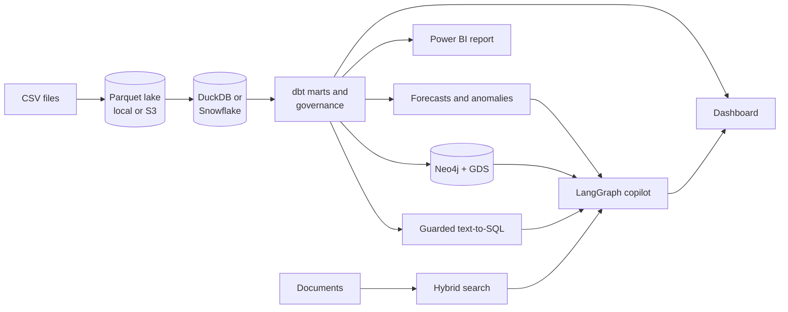
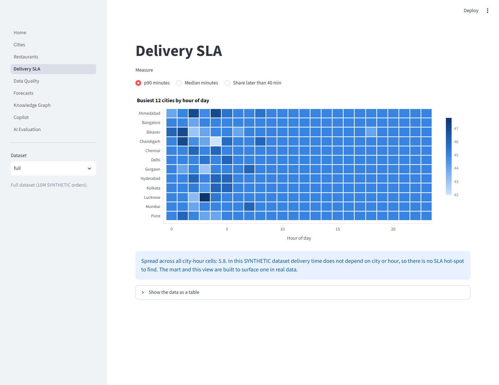

# Zomato Business Metrics & Operations Analytics

The daily numbers a food-delivery operation runs on, by city: what was sold, what was cancelled
or late, whether today is unusual, and what the next two weeks look like, with checks that the
numbers can be trusted. Underneath is a data platform with forecasting, alerting and an AI
assistant that runs free on a laptop.

> **About the data:** the orders and reviews are synthetic, and the restaurant and menu data look
> scraped from a real delivery site. Every number describes this dataset, not Zomato's business.
> Incidents planted to test a detector are labelled SYNTHETIC. The data isn't in this repo.

**The problem.** An operations team needs to know each morning which cities are on track, which
deliveries are running late, and whether a dip is a real incident or normal noise, and it needs to
trust the numbers before acting on them.

**Who it's for.** City and operations managers who review the morning numbers, program managers
who track delivery SLAs and plan capacity, and analysts who answer the follow-up questions.

| KPI tracked | How it's cut |
|---|---|
| Delivered GMV, orders, average order value | daily, by city |
| Cancellation rate, discount rate, active customers | daily, by city |
| Late deliveries (slower than the 40-minute promise) | daily nationally; by city and hour of day |
| Forecast against actual (orders and GMV) | daily, nationally and for the 10 busiest cities |

| Headline | What it means |
|---|---|
| **35.1M rows** refreshed end to end in **237.3 s** | the whole pipeline, all seven source files, on a laptop |
| **0.64%** average daily forecast error | against 1.16% for "same as last week" |
| **85.4%** of planted incidents caught by the daily alert | against 7.8% for a plain z-score alert (SYNTHETIC incidents) |
| **1,068,344** records flagged by 26 data-quality rules | 273 of them quarantined before reaching a report |


**Status:** the local pipeline, forecasts, alerts, weekly digest and Streamlit dashboard run and
are measured ([docs/METRICS.md](docs/METRICS.md), runs of 2026-11-02). The S3/Snowflake, Airflow
and Neo4j paths are built, but their runs aren't part of that validation. The Power BI report is
prepared but not built yet.

[](https://github.com/Dracula-5/zomato-data-analytics/actions/workflows/ci.yml)

## Business insights

Five findings from the real outputs on the full dataset, written for an operations or program
manager. **The orders are synthetic**, so read these as what the dashboards would tell you, not as
facts about Zomato. Every number comes from
[docs/insights/RESULTS.md](docs/insights/RESULTS.md), which `make insights` regenerates from the
SQL files beside it.

**1. Saturdays bring 60.9% more orders than Wednesdays.**
- *Finding:* over the last 12 months, Saturdays averaged 18,462 orders and Wednesdays 11,474
  (+60.9%). Friday is +35.5% and Sunday +45.4%; Monday to Thursday are within 5.2% of each other.
- *Why it matters:* riders, restaurant prep and support sized for the weekly average are short on
  three days out of seven.
- *Recommended action:* plan supply by weekday from the forecast (insight 4), with Friday to Sunday
  as peak days.
- *Metric to track:* orders by weekday against forecast, and the late-delivery rate on Friday to
  Sunday.

**2. One delivery in five is late, at every hour and in every large city.**
- *Finding:* 19.4% of 9,150,122 delivered orders took longer than the 40-minute promise. The
  median delivery takes 31 minutes and the slowest tenth 45 minutes or more. The late share stays
  between 19.2% and 19.7% across hours of the day, although the busiest hour has 119 times the
  orders of the quietest, and between 19.3% and 19.5% across the 10 largest cities.
- *Why it matters:* lateness that doesn't rise with load isn't a peak-capacity problem, so adding
  riders at peak hours wouldn't reduce it. It comes from where the promise sits against normal
  delivery times. (In this synthetic data, delivery time doesn't depend on load; on real data,
  this is the first thing to check.)
- *Recommended action:* review the 40-minute promise against the delivery-time distribution, and
  find what drives the slowest tenth of orders before funding more peak-hour supply.
- *Metric to track:* late-delivery rate by hour and city, and the 90th-percentile delivery time.

**3. Ten of 552 cities hold 61.6% of GMV.**
- *Finding:* over the last 12 months, the top 10 cities took 61.6% of delivered GMV and 44 cities
  took 80%. Bangalore alone took 12.2%. Average order value ranges from ₹442 in Chandigarh to ₹611
  in Mumbai among the top 10, while cancellations sit between 5.9% and 6.0% in all of them.
- *Why it matters:* a problem in one large city moves the national numbers, while the same problem
  in a small city vanishes in them.
- *Recommended action:* tier the monitoring: daily review and alerts for the top 10 cities, weekly
  for the next 34, monthly for the rest. Set order-value targets per city, not nationally.
- *Metric to track:* the top 10 cities' share of GMV, and each city's AOV and cancellation rate
  against its own baseline.

**4. The demand forecast is accurate enough to plan two weeks ahead.**
- *Finding:* the forecast's average daily error on national orders is 0.64%, against 1.16% for
  "same as last week", over 8 tests of 14 days each on days it hadn't seen. It expects 222,779
  orders for 1 to 14 July 2026, 0.7% more than the previous 14 days, and ₹9.83 crore of GMV (+0.6%).
- *Why it matters:* below 1% daily error, staffing and promotions can be planned against the
  forecast instead of last week's numbers.
- *Recommended action:* publish the 14-day forecast every week, and treat any day that lands
  outside its expected range as an exception to explain.
- *Metric to track:* daily actual against forecast (GMV vs Forecast % in the Power BI report) and
  the forecast's MAPE.

**5. Alerts catch big drops reliably and small ones only sometimes.**
- *Finding:* on incidents planted on purpose (SYNTHETIC), the daily alert caught 99.9% of 50% drops
  in a series, 89.9% of 30% drops and 63.7% of 20% drops, at 2.08 false alarms per 1,000 normal
  days. A plain z-score alert caught 7.8% of all incidents. On the real data it flagged 48 of 20,064
  series-days, close to the 42 its false-alarm rate predicts, so nothing stands out beyond noise.
- *Why it matters:* 36.3% of 20% drops go unflagged on the day, and a 20% loss in a large city is
  a real loss.
- *Recommended action:* use the daily alert for large incidents and the weekly digest, which tests
  each city's week against noise ([sample](docs/sample_digest.md)), for smaller, slower declines.
- *Metric to track:* share of incidents caught by size, false alarms per 1,000 days, and time to
  detect.

## What the checks found

The most useful results came from checking things that looked true.

| Looked like | Turned out to be | How it was checked |
|---|---|---|
| Passing dbt tests means the source is clean | Quality rules still flagged records and quarantined malformed rows | dbt tests plus a separate rule catalogue |
| Matrix factorization's lift over random proves taste | A shuffled-order control also gets above-random recall, so lift alone is not evidence of taste | Temporal split with popularity, shuffled and planted-taste controls |
| LightGBM is the best forecaster | ETS scores better and is at the estimated noise floor | Walk-forward validation against a seasonal-naive baseline |
| A good anomaly recall means outages are easy to detect | The detector misses most of the smaller planted outage case | Held-out SIMULATED replay, split by outage size |
| Faithfulness means an answer is true | It only measures support from retrieved passages | Golden set plus citation checks; inspect misses |
| Incremental models always make the whole build faster | Performance is measured separately for fact models and the whole project | Repeated DuckDB benchmark with result reconciliation |

Every figure is in **[docs/METRICS.md](docs/METRICS.md)**, which `make metrics` regenerates from the
files real runs left behind. Anything no run has produced says "not run".

## What's in it



| Area | Tools |
|---|---|
| Ingestion and quality | Python, schema contracts, drift detection, Great Expectations |
| Warehouse | DuckDB, Snowflake, dbt with incremental facts and an SCD2 snapshot |
| Orchestration | Airflow 3 in Docker, with retries, deadline alerts and idempotent loads |
| Cloud | Terraform, S3, keyless IAM integration, masking policies, least-privilege roles |
| Forecasting | ETS and LightGBM with walk-forward backtests, plus anomaly detection |
| Graph | Neo4j and GDS: node similarity, Louvain and PageRank |
| Streaming | A SIMULATED order feed with offsets, a watermark for late events and Poisson alerting |
| Scheduled analysis | A weekly digest that tests each change against noise, on the Airflow schedule |
| GenAI | Hybrid retrieval, Pydantic-validated output, text-to-SQL with a parsing guard, LangGraph |
| Business intelligence | Power BI: a star schema exported from the dbt marts, DAX measures, a theme and a build guide (report file pending) |
| Engineering | pytest, mypy strict, ruff, pre-commit, gitleaks, GitHub Actions |

## Run it

You need [uv](https://docs.astral.sh/uv/) and `make`. No data or accounts are needed for the demo.

```bash
uv sync --all-groups   # install exact versions from uv.lock
make demo              # the whole pipeline on a generated SYNTHETIC dataset
make app               # open the dashboard at http://localhost:8501
make bi-export         # CSV files for the Power BI report, in bi/data/
make check             # lint, type check and tests
```

With the source CSVs, set `DATA_DIR` in `.env` (see [.env.example](.env.example)), then:

```bash
make local             # a 5% sample by user, free
make local-full        # all of the data, free
make forecast          # backtests and anomaly scores
make recsys            # the recommender audit
make stream            # the SIMULATED live feed, for the Live Ops page
make digest            # the weekly analysis
make metrics           # regenerate docs/METRICS.md
```

Cloud, graph and Airflow steps are in [docs/CLOUD_SETUP.md](docs/CLOUD_SETUP.md) and `make help`.
Paid LLM calls need `LLM_MODE=live` set for that run. Otherwise answers replay from `eval/replay/`,
so tests and CI can't spend anything.

## Power BI dashboard

A two-page Power BI report on the dbt marts, for readers who don't write SQL. **Business
Overview** shows GMV, orders, average order value and cancellation rate, with a GMV trend, the top
cities, and city and date slicers. **Forecast vs Actual** puts the ETS forecast against what
happened, with its 80% band, its error and a plain-English note on what it says.

`make bi-export` writes a star schema to `bi/data/` as CSV files: `mart_city_daily`,
`mart_daily_kpis`, `dim_city`, `dim_date` and `forecast_vs_actual`. It uses the full warehouse
when that's built and the SYNTHETIC fixture otherwise, so it also runs after `make demo`. The
forecast rows are the walk-forward ETS backtest that METRICS.md scores, not a new model. Power BI
Desktop is a Windows app, so the report itself is built by hand:
[bi/POWER_BI_GUIDE.md](bi/POWER_BI_GUIDE.md) gives every click, with the DAX in
[bi/measures.dax](bi/measures.dax) and a colorblind-safe theme in [bi/theme.json](bi/theme.json).

**Status:** the export, guide, measures and theme are done. The report file
(`bi/zomato_platform.pbix`) and its screenshots are **pending**.

<!-- Screenshots: delete this line and the closing line once the PNGs are in bi/screenshots/.
<p>
  
  
</p>
<p>
  
</p>
-->

## Public web demo (Render + Vercel)

The repository includes a React/Vite frontend in [web/](web/) and a read-only FastAPI API in
[src/zap/api.py](src/zap/api.py). The Render image builds its own SYNTHETIC fixture warehouse;
the public frontend does not depend on your ignored local data. Follow
[docs/DEPLOY_RENDER_VERCEL.md](docs/DEPLOY_RENDER_VERCEL.md) to connect the repo to Render and
Vercel and configure CORS safely.

## Status

The local path has been run on the full source data and the 5% user sample. `make check` and
`make demo` pass; measured results and their artifact sources are in
[docs/METRICS.md](docs/METRICS.md). The source orders and reviews are synthetic, so the figures
describe this dataset, not real delivery operations.

The implementation includes cloud deployment, Airflow and Neo4j/GDS paths, but those services
were **not run in this validation**: cloud credentials are not configured and the Docker daemon is
unavailable. Live LLM calls were not made; the dashboard defaults to saved-answer replay. The
stored evaluation results and their limitations are documented in
[docs/EVALUATION.md](docs/EVALUATION.md).

The Render API and Vercel frontend are now scaffolded, but have **not been deployed** to public
URLs. Their public demo uses a synthetic DuckDB fixture; follow
[docs/DEPLOY_RENDER_VERCEL.md](docs/DEPLOY_RENDER_VERCEL.md) to deploy them with your own accounts.

No real-time order feed is publicly available, so the Live Ops page replays past orders and labels
the feed SIMULATED. Its held-out results, including the smaller outages it misses, are in
[docs/LIVE_FEED.md](docs/LIVE_FEED.md).

## Screenshots

| Overview | Live Ops |
|---|---|
|  |  |

| Forecasts | Copilot |
|---|---|
|  |  |

| Data quality | AI evaluation |
|---|---|
|  |  |

| Delivery SLA | Knowledge graph |
|---|---|
|  |  |

## Read more

| Document | What's in it |
|---|---|
| [METRICS.md](docs/METRICS.md) | Every measured result, with its source file |
| [EVALUATION.md](docs/EVALUATION.md) | The AI scores, the misses, and what they can't tell you |
| [LIVE_FEED.md](docs/LIVE_FEED.md) | The SIMULATED stream, its alerts, and how well they work |
| [ARCHITECTURE.md](docs/ARCHITECTURE.md) | How the system fits together, and its security controls |
| [BUSINESS_CASE.md](docs/BUSINESS_CASE.md) | What this is worth, and what the data can't support |
| [Decision records](docs/adr/) | The five choices that shaped the project |
| [LEARNING_NOTES.md](docs/LEARNING_NOTES.md) | What was built each milestone, and what went wrong |
| [DATA_DICTIONARY.md](docs/DATA_DICTIONARY.md) | Every table and column |
| [CLOUD_SETUP.md](docs/CLOUD_SETUP.md) | Exact steps for AWS and Snowflake, with costs |
| [DEPLOY_RENDER_VERCEL.md](docs/DEPLOY_RENDER_VERCEL.md) | Public demo deployment on Render and Vercel |
| [POWER_BI_GUIDE.md](bi/POWER_BI_GUIDE.md) | Building the Power BI report, click by click |
