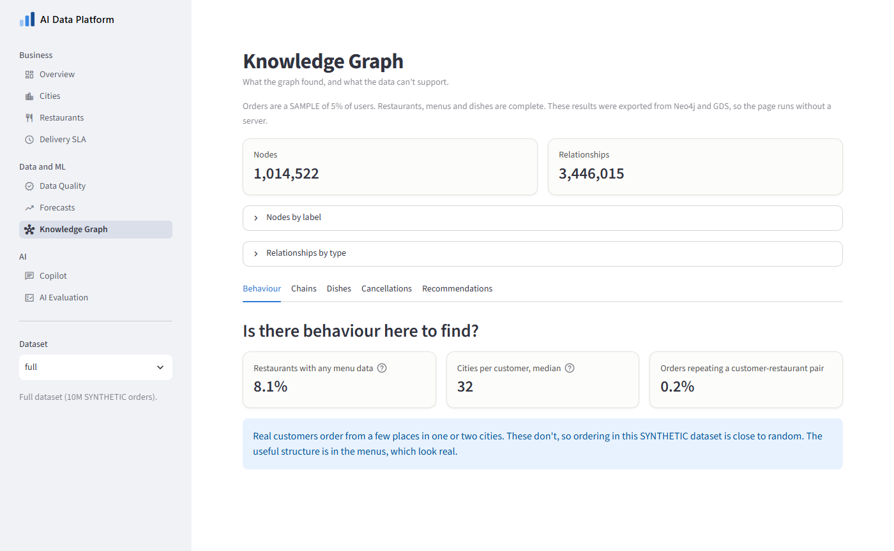
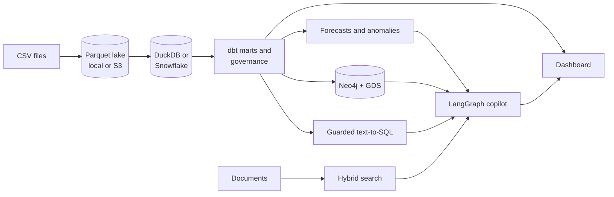
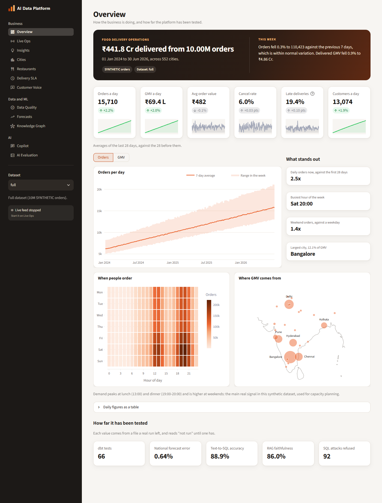
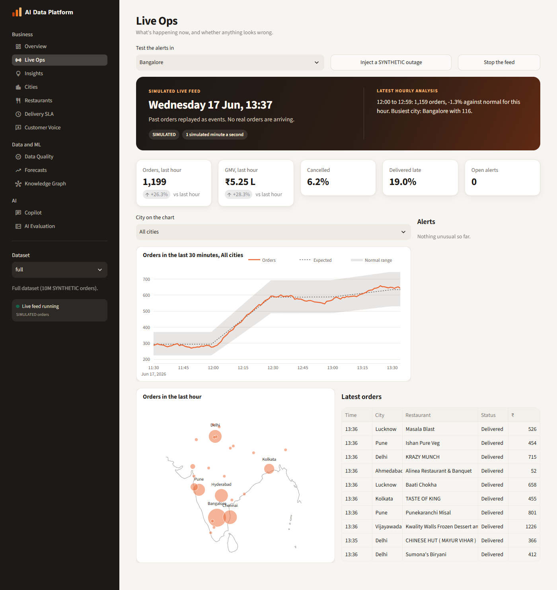
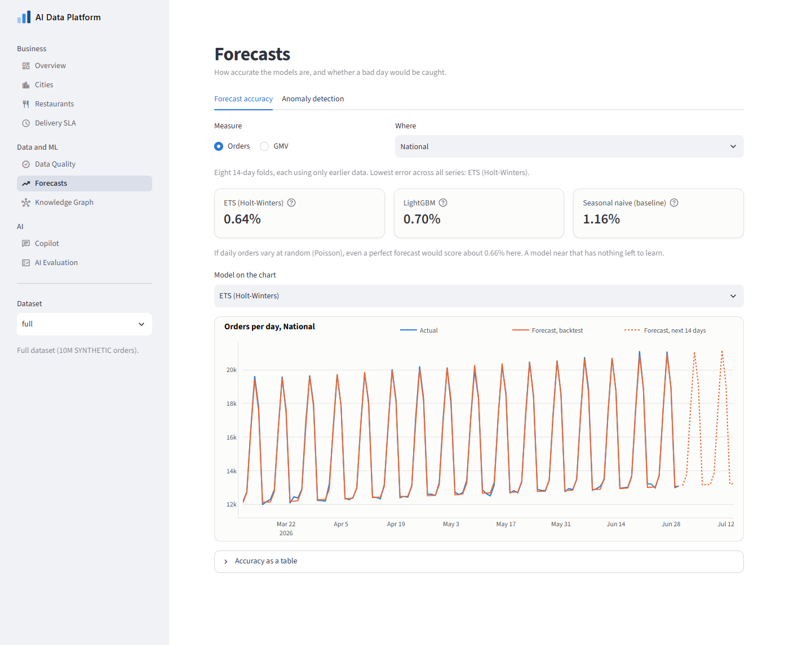
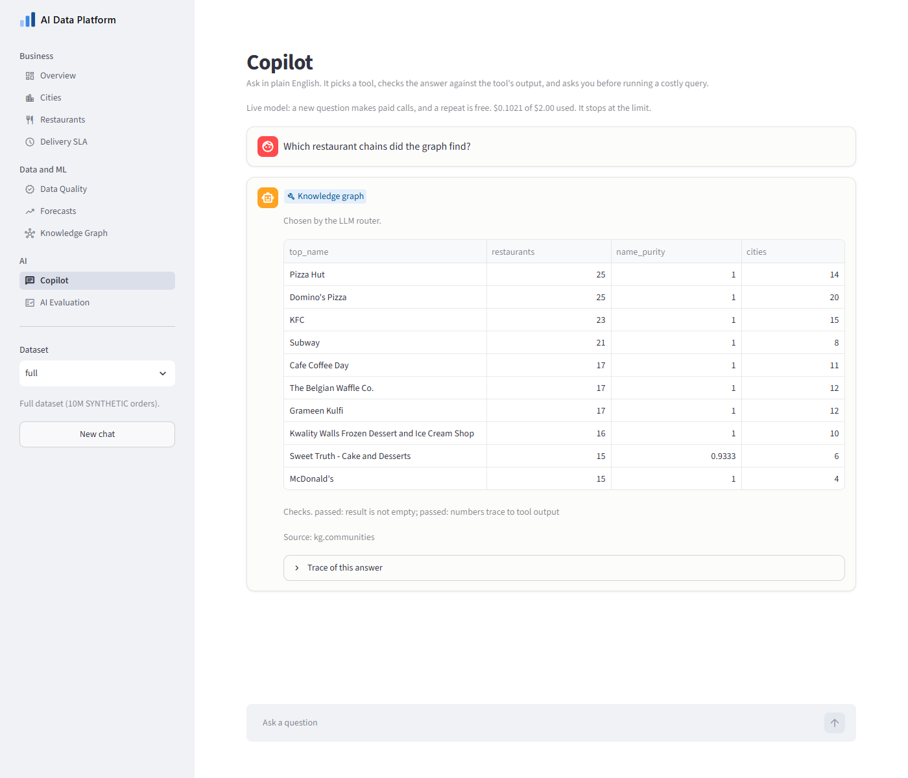
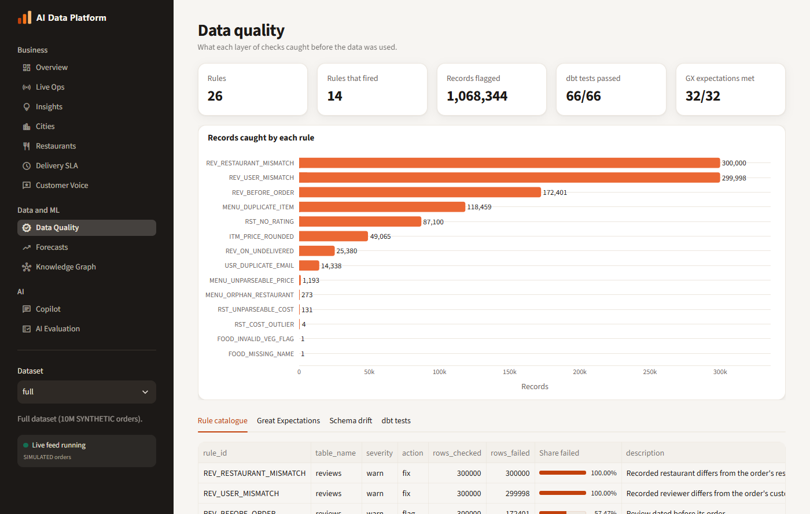
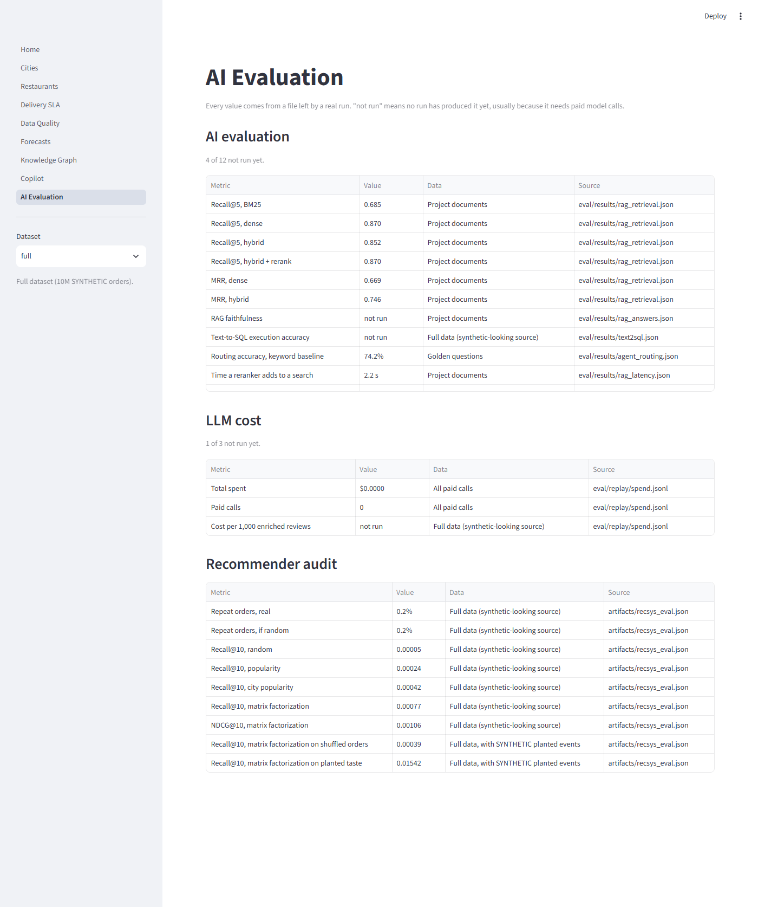

# Zomato AI Data Platform

A food-delivery data platform that takes raw files through to dashboards, forecasts, a knowledge
graph and an AI copilot, and is built to say what its data can't support.

It runs for free on a laptop with DuckDB. Optional S3 and Snowflake deployment paths are included
but require cloud accounts and credentials.

> **About the data:** the orders and reviews are synthetic, while the restaurant and menu data looks
> scraped from a real delivery site. Results describe this dataset, not real food delivery, and
> anything planted to test a detector is labelled SYNTHETIC. The data isn't in this repo.

[](https://github.com/Dracula-5/zomato-data-analytics/actions/workflows/ci.yml)



## What it found

The most useful results came from checking things that looked true.

| Looked like | Turned out to be | How it was checked |
|---|---|---|
| Passing dbt tests means the source is clean | Quality rules still flagged records and quarantined malformed rows | dbt tests plus a separate rule catalogue |
| Matrix factorization's lift over random proves taste | A shuffled-order control also gets above-random recall, so lift alone is not evidence of taste | Temporal split with popularity, shuffled and planted-taste controls |
| LightGBM is the best forecaster | ETS scores better and is at the estimated noise floor | Walk-forward validation against a seasonal-naive baseline |
| A good anomaly recall means outages are easy to detect | The detector misses most of the smaller planted outage case | Held-out SIMULATED replay, split by outage size |
| Faithfulness means an answer is true | It only measures support from retrieved passages | Golden set plus citation checks; inspect misses |
| Incremental models always make the whole build faster | Performance is measured separately for fact models and the whole project | Repeated DuckDB benchmark with result reconciliation |

Every figure is in **[docs/METRICS.md](docs/METRICS.md)**, which `make metrics` regenerates from the
files real runs left behind. Anything no run has produced says "not run".

## What's in it



| Area | Tools |
|---|---|
| Ingestion and quality | Python, schema contracts, drift detection, Great Expectations |
| Warehouse | DuckDB, Snowflake, dbt with incremental facts and an SCD2 snapshot |
| Orchestration | Airflow 3 in Docker, with retries, deadline alerts and idempotent loads |
| Cloud | Terraform, S3, keyless IAM integration, masking policies, least-privilege roles |
| Forecasting | ETS and LightGBM with walk-forward backtests, plus anomaly detection |
| Graph | Neo4j and GDS: node similarity, Louvain and PageRank |
| Streaming | A SIMULATED order feed with offsets, a watermark for late events and Poisson alerting |
| Scheduled analysis | A weekly digest that tests each change against noise, on the Airflow schedule |
| GenAI | Hybrid retrieval, Pydantic-validated output, text-to-SQL with a parsing guard, LangGraph |
| Engineering | pytest, mypy strict, ruff, pre-commit, gitleaks, GitHub Actions |

## Run it

You need [uv](https://docs.astral.sh/uv/) and `make`. No data or accounts are needed for the demo.

```bash
uv sync --all-groups   # install exact versions from uv.lock
make demo              # the whole pipeline on a generated SYNTHETIC dataset
make app               # open the dashboard at http://localhost:8501
make check             # lint, type check and tests
```

With the source CSVs, set `DATA_DIR` in `.env` (see [.env.example](.env.example)), then:

```bash
make local             # a 5% sample by user, free
make local-full        # all of the data, free
make forecast          # backtests and anomaly scores
make recsys            # the recommender audit
make stream            # the SIMULATED live feed, for the Live Ops page
make digest            # the weekly analysis
make metrics           # regenerate docs/METRICS.md
```

Cloud, graph and Airflow steps are in [docs/CLOUD_SETUP.md](docs/CLOUD_SETUP.md) and `make help`.
Paid LLM calls need `LLM_MODE=live` set for that run. Otherwise answers replay from `eval/replay/`,
so tests and CI can't spend anything.

## Public web demo (Render + Vercel)

The repository includes a React/Vite frontend in [web/](web/) and a read-only FastAPI API in
[src/zap/api.py](src/zap/api.py). The Render image builds its own SYNTHETIC fixture warehouse;
the public frontend does not depend on your ignored local data. Follow
[docs/DEPLOY_RENDER_VERCEL.md](docs/DEPLOY_RENDER_VERCEL.md) to connect the repo to Render and
Vercel and configure CORS safely.

## Status

The local path has been run on the full source data and the 5% user sample. `make check` and
`make demo` pass; measured results and their artifact sources are in
[docs/METRICS.md](docs/METRICS.md). The source orders and reviews are synthetic, so the figures
describe this dataset, not real delivery operations.

The implementation includes cloud deployment, Airflow and Neo4j/GDS paths, but those services
were **not run in this validation**: cloud credentials are not configured and the Docker daemon is
unavailable. Live LLM calls were not made; the dashboard defaults to saved-answer replay. The
stored evaluation results and their limitations are documented in
[docs/EVALUATION.md](docs/EVALUATION.md).

The Render API and Vercel frontend are now scaffolded, but have **not been deployed** to public
URLs. Their public demo uses a synthetic DuckDB fixture; follow
[docs/DEPLOY_RENDER_VERCEL.md](docs/DEPLOY_RENDER_VERCEL.md) to deploy them with your own accounts.

No real-time order feed is publicly available, so the Live Ops page replays past orders and labels
the feed SIMULATED. Its held-out results, including the smaller outages it misses, are in
[docs/LIVE_FEED.md](docs/LIVE_FEED.md).

## Screenshots

| Overview | Live Ops |
|---|---|
|  |  |

| Forecasts | Copilot |
|---|---|
|  |  |

| Data quality | AI evaluation |
|---|---|
|  |  |

## Read more

| Document | What's in it |
|---|---|
| [METRICS.md](docs/METRICS.md) | Every measured result, with its source file |
| [EVALUATION.md](docs/EVALUATION.md) | The AI scores, the misses, and what they can't tell you |
| [LIVE_FEED.md](docs/LIVE_FEED.md) | The SIMULATED stream, its alerts, and how well they work |
| [ARCHITECTURE.md](docs/ARCHITECTURE.md) | How the system fits together, and its security controls |
| [BUSINESS_CASE.md](docs/BUSINESS_CASE.md) | What this is worth, and what the data can't support |
| [Decision records](docs/adr/) | The five choices that shaped the project |
| [LEARNING_NOTES.md](docs/LEARNING_NOTES.md) | What was built each milestone, and what went wrong |
| [DATA_DICTIONARY.md](docs/DATA_DICTIONARY.md) | Every table and column |
| [CLOUD_SETUP.md](docs/CLOUD_SETUP.md) | Exact steps for AWS and Snowflake, with costs |
| [DEPLOY_RENDER_VERCEL.md](docs/DEPLOY_RENDER_VERCEL.md) | Public demo deployment on Render and Vercel |
