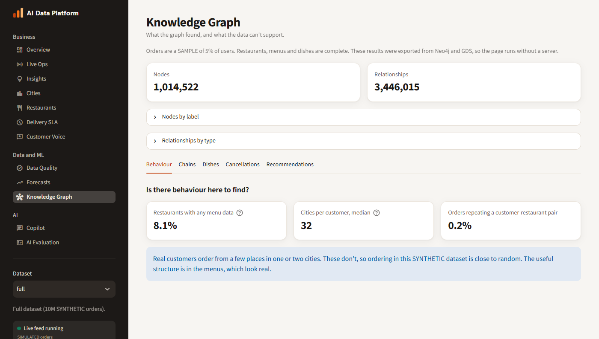
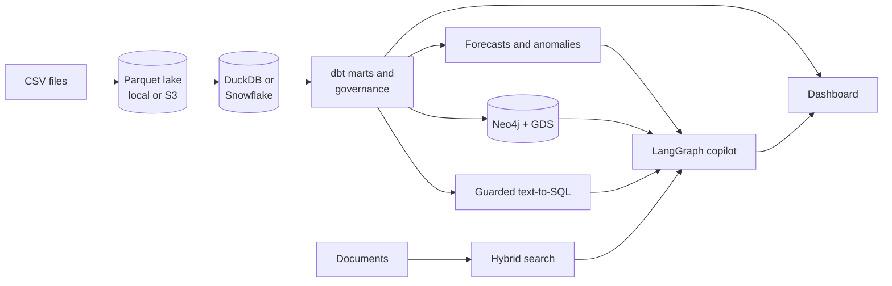
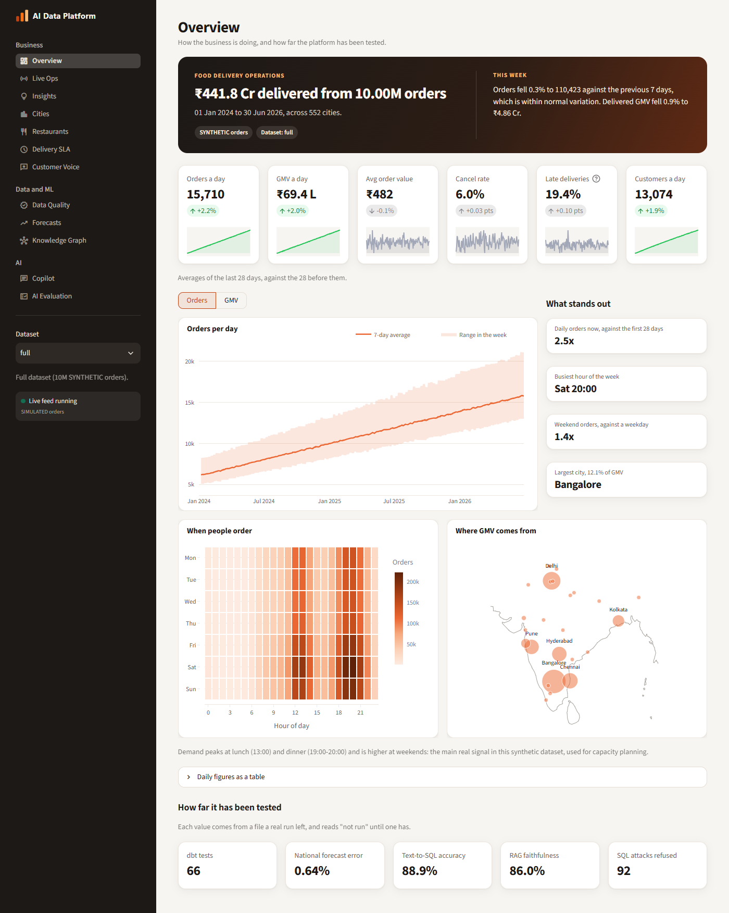
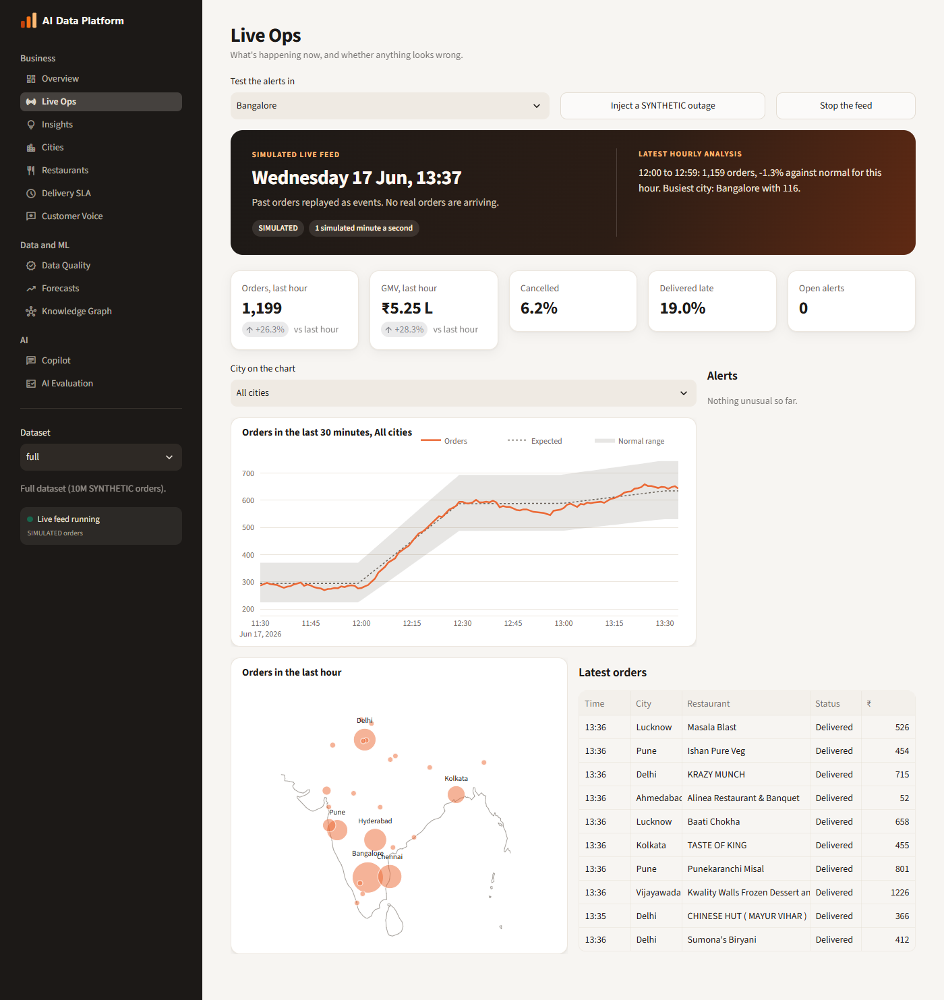
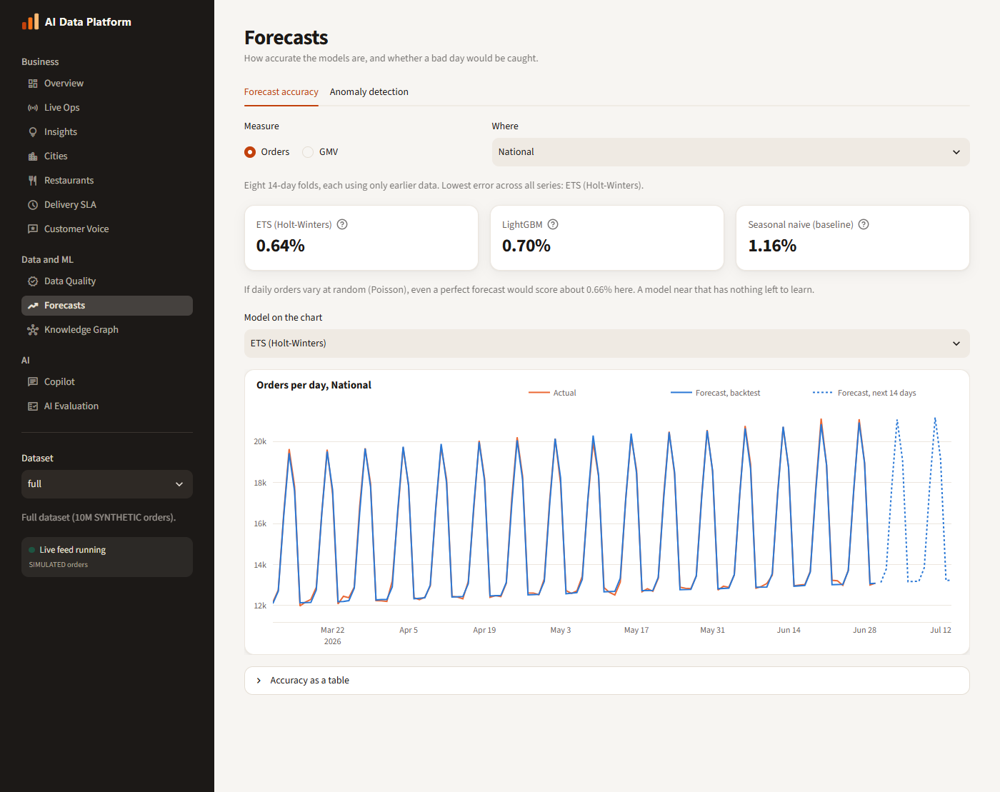
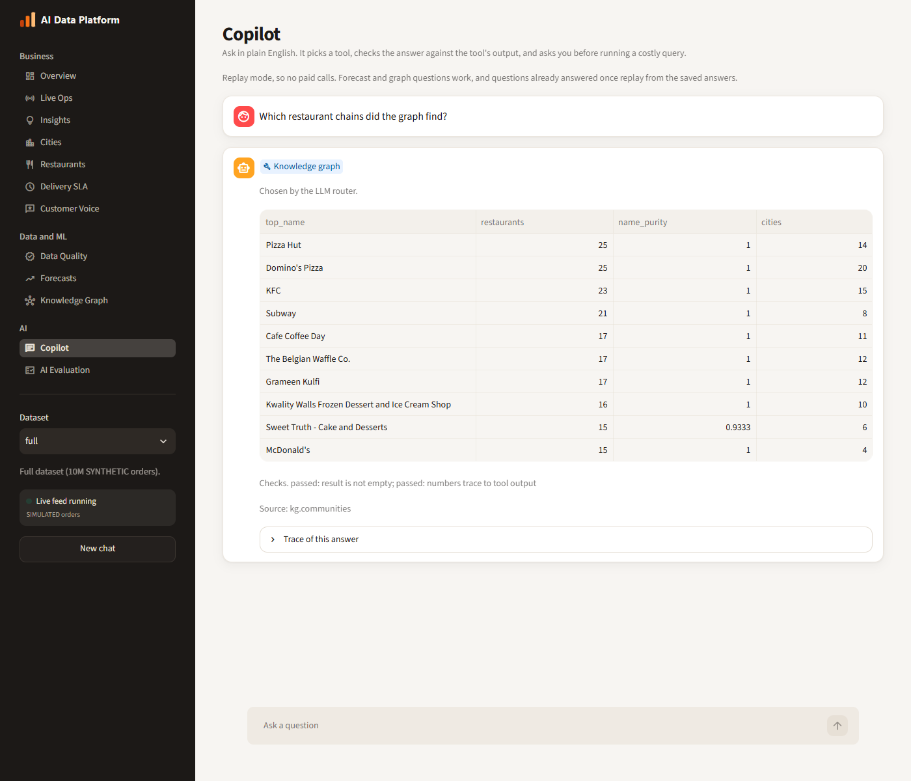
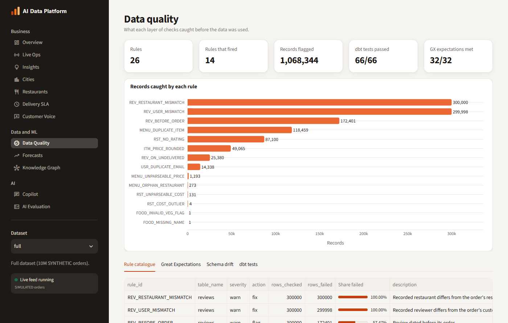
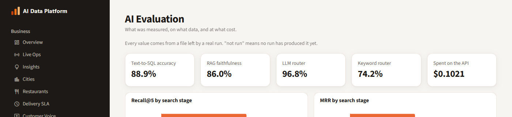

# Zomato AI Data Platform

A food-delivery data platform that takes raw files through to dashboards, forecasts, a knowledge
graph and an AI copilot, and is built to say what its data can't support.

It runs for free on a laptop with DuckDB, and the same project runs on S3 and Snowflake.

> **About the data:** the orders and reviews are synthetic, while the restaurant and menu data looks
> scraped from a real delivery site. Results describe this dataset, not real food delivery, and
> anything planted to test a detector is labelled SYNTHETIC. The data isn't in this repo.

[](https://github.com/Dracula-5/zomato-data-analytics/actions/workflows/ci.yml)



## What it found

The most useful results came from checking things that looked true.

| Looked like | Turned out to be | How it was checked |
|---|---|---|
| All 88 dbt tests pass, so the numbers are right | Snowflake rounded some rates twice | Comparing every table across the two engines |
| 9,791 linked dish pairs | None: each restaurant sells a small pool of dishes | Testing within each restaurant |
| 4,595 cancel-heavy restaurants | None, of 148,103 tested | Correcting for testing thousands at once |
| The recommender beats random 15 times over | Popularity, not taste | Running it on shuffled orders |
| LightGBM would beat a simple model | ETS already sits on the noise floor | Estimating the best possible error first |
| 100% sentiment accuracy | 294 templated sentences, so it says little | Reading what the model was given |
| A judge that clears an answer means it's right | It can pass a wrong answer built on the wrong passages | Checking the citations separately |

What held up: chains and what look like shared-kitchen brands, found from menus alone with no names
given to the algorithm.

Every figure is in **[docs/METRICS.md](docs/METRICS.md)**, which `make metrics` regenerates from the
files real runs left behind. Anything no run has produced says "not run".

## What's in it



| Area | Tools |
|---|---|
| Ingestion and quality | Python, schema contracts, drift detection, Great Expectations |
| Warehouse | DuckDB, Snowflake, dbt with incremental facts and an SCD2 snapshot |
| Orchestration | Airflow 3 in Docker, with retries, deadline alerts and idempotent loads |
| Cloud | Terraform, S3, keyless IAM integration, masking policies, least-privilege roles |
| Forecasting | ETS and LightGBM with walk-forward backtests, plus anomaly detection |
| Graph | Neo4j and GDS: node similarity, Louvain and PageRank |
| Streaming | A SIMULATED order feed with offsets, a watermark for late events and Poisson alerting |
| Scheduled analysis | A weekly digest that tests each change against noise, on the Airflow schedule |
| GenAI | Hybrid retrieval, Pydantic-validated output, text-to-SQL with a parsing guard, LangGraph |
| Engineering | pytest, mypy strict, ruff, pre-commit, gitleaks, GitHub Actions |

## Run it

You need [uv](https://docs.astral.sh/uv/) and `make`. No data or accounts are needed for the demo.

```bash
uv sync --all-groups   # install exact versions from uv.lock
make demo              # the whole pipeline on a generated SYNTHETIC dataset
make app               # open the dashboard at http://localhost:8501
make check             # lint, type check and tests
```

With the source CSVs, set `DATA_DIR` in `.env` (see [.env.example](.env.example)), then:

```bash
make local             # a 5% sample by user, free
make local-full        # all of the data, free
make forecast          # backtests and anomaly scores
make recsys            # the recommender audit
make stream            # the SIMULATED live feed, for the Live Ops page
make digest            # the weekly analysis
make metrics           # regenerate docs/METRICS.md
```

Cloud, graph and Airflow steps are in [docs/CLOUD_SETUP.md](docs/CLOUD_SETUP.md) and `make help`.
Paid LLM calls need `LLM_MODE=live` set for that run. Otherwise answers replay from `eval/replay/`,
so tests and CI can't spend anything.

## Status

Everything is built, tested and measured. The paid evaluations cost about $0.10 of a $2 budget:
88.9% text-to-SQL accuracy, 86.0% answer faithfulness, and 96.8% routing accuracy against a 74.2%
keyword baseline. [docs/EVALUATION.md](docs/EVALUATION.md) goes through the misses and what these
numbers can't tell you.

No real-time order feed is publicly available, so the live feed replays past orders and says so on
every page. On days held out from its design it found 14 of 14 total city outages, at a median of 16
simulated minutes, with 1 false alarm in 14 days. It misses a 30% loss. See
[docs/LIVE_FEED.md](docs/LIVE_FEED.md).

The dashboard's copilot replays saved answers by default. `LLM_MODE=live make app` lets it answer new
questions, which makes small paid calls, and it shows the spend and stops at `LLM_BUDGET_USD`.

## Screenshots

| Overview | Live Ops |
|---|---|
|  |  |

| Forecasts | Copilot |
|---|---|
|  |  |

| Data quality | AI evaluation |
|---|---|
|  |  |

## Read more

| Document | What's in it |
|---|---|
| [METRICS.md](docs/METRICS.md) | Every measured result, with its source file |
| [EVALUATION.md](docs/EVALUATION.md) | The AI scores, the misses, and what they can't tell you |
| [LIVE_FEED.md](docs/LIVE_FEED.md) | The SIMULATED stream, its alerts, and how well they work |
| [ARCHITECTURE.md](docs/ARCHITECTURE.md) | How the system fits together, and its security controls |
| [BUSINESS_CASE.md](docs/BUSINESS_CASE.md) | What this is worth, and what the data can't support |
| [Decision records](docs/adr/) | The five choices that shaped the project |
| [LEARNING_NOTES.md](docs/LEARNING_NOTES.md) | What was built each milestone, and what went wrong |
| [DATA_DICTIONARY.md](docs/DATA_DICTIONARY.md) | Every table and column |
| [CLOUD_SETUP.md](docs/CLOUD_SETUP.md) | Exact steps for AWS and Snowflake, with costs |
