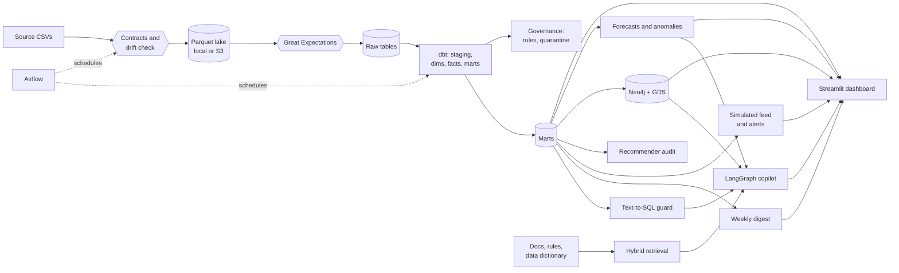
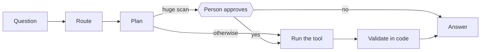

# Architecture

How data moves through the platform, and why it's built this way. For measured results, see
[METRICS.md](METRICS.md). For the reasoning behind the main choices, see the [ADRs](adr/).

## The whole system

The same dbt project and contracts run on two warehouses: DuckDB on a laptop, for free, and
Snowflake in the cloud. Only `macros/cross_db.sql` knows they differ.

## Layers

| Layer | What it does | Code |
|---|---|---|
| Ingestion | Checks each file against its schema contract, stops on breaking drift, writes partitioned Parquet | `src/zap/ingest/`, `contracts/` |
| Validation | Great Expectations gate on the lake, before anything loads | `src/zap/quality/` |
| Warehouse | DuckDB or Snowflake raw tables, each replaced in one transaction | `src/zap/warehouse/`, `src/zap/cloud/` |
| Transformation | dbt staging, dimensions, incremental facts, SCD2 snapshot, business marts | `dbt/zomato/` |
| Governance | 26 quality rules, a quarantine table, PII masking, a generated data dictionary | `dbt/zomato/models/governance/` |
| Orchestration | Airflow 3 DAGs with retries, deadline alerts and idempotent daily loads | `airflow/` |
| Forecasting | Seasonal naive, ETS and LightGBM with walk-forward backtests, plus anomaly detection | `src/zap/forecast/` |
| Knowledge graph | Neo4j with GDS, plus statistics that separate real patterns from noise | `src/zap/kg/` |
| Recommender audit | Signal audit and baselines on a temporal split | `src/zap/recsys/` |
| GenAI | LLM client with a budget, retrieval over documents, guarded text-to-SQL | `src/zap/llm/`, `src/zap/rag/`, `src/zap/text2sql/`, `src/zap/enrich/` |
| Agent | LangGraph flow with routing, approval and deterministic validation | `src/zap/agent/` |
| Live feed | A SIMULATED order stream, minute windows and alerts, on a SQLite log | `src/zap/stream/` |
| Scheduled analysis | A weekly digest that tests changes against noise, with a checked summary | `src/zap/insights/` |
| Dashboard | Twelve Streamlit pages over the marts, the feed and published results | `app/`, `src/zap/dashboard/` |
| Infrastructure | Terraform for S3 and IAM, versioned SQL for Snowflake, GitHub Actions for CI | `infra/`, `.github/` |

## Data flow in detail

**Ingestion is contract-first.** Each table has a YAML contract with its columns, types and
classifications. Columns classified `secret`, such as passwords, are dropped at this step, so they
never reach the lake, S3 or a warehouse.

**Medallion layers.** `raw` holds what arrived, unedited. `staging` holds one cleaned view per
source. `marts` holds what people query. `governance` holds data about the data: which record
broke which rule.

**Bad data is counted, not dropped silently.** A rule either flags a record or quarantines it,
and both are reported in the governance tables.

**Idempotent by design.** Each table goes to a temporary folder, its row count is checked against
the source, and only then does it replace the old data. Daily runs delete that day's rows and load
them again in one transaction, so a repeated run changes nothing. Fingerprints prove it.

**Incremental facts.** `fct_orders` reprocesses a three-day window and merges on the key, because
recent orders can arrive late or change. A fingerprint test confirms that day-by-day runs end in
the same state as a full rebuild.

## Security

| Concern | Control |
|---|---|
| AWS access from Snowflake | IAM role with an external ID, so no AWS key is stored in Snowflake |
| Snowflake service sign-in | Key pair only: no password and no web UI |
| Grants | Managed access schemas, so the deployer role needs no account-wide `MANAGE GRANTS` |
| Passwords in the source | Dropped at ingestion |
| Email | Masked and hashed in marts, and hidden by a masking policy from all but the deployer |
| Generated SQL | Parsed by a guard, limited to tables with no personal data, run read-only with no file access |
| Secrets in Git | gitleaks in pre-commit and in CI, and `.env`, `*.tfvars` and `*.p8` are ignored |
| LLM spending | Replay by default, and a hard budget checked before each call |

## How the copilot decides

A model shouldn't mark its own work, so validation is deterministic: the SQL must pass the guard,
the result must not be empty, every number in the answer must appear in the tool's output, and
every citation must be a passage that was retrieved. An answer that fails isn't shown.

Forecast and graph questions read stored results and need no model. If the model is unavailable,
routing falls back to keywords, whose accuracy is measured, and other questions say so plainly.

## Decisions

1. [One dbt project, two warehouses](adr/0001-one-dbt-project-two-warehouses.md)
2. [Incremental facts with a lookback window](adr/0002-incremental-facts-with-a-lookback.md)
3. [Guarding generated SQL by parsing it](adr/0003-guarding-generated-sql.md)
4. [Building the graph on menus, not orders](adr/0004-graph-on-menus-not-orders.md)
5. [Simple models, because the data can't reward complex ones](adr/0005-simple-models-over-complex.md)
6. [A labelled simulation, on a SQLite log](adr/0006-a-labelled-simulation-on-a-sqlite-log.md)
