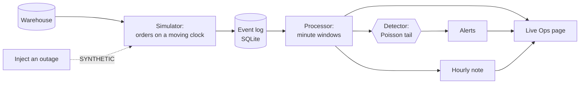

# The live feed

A stream of orders, processed as they arrive, with alerts when a city's orders look wrong. The
reasoning is in [ADR 6](adr/0006-a-labelled-simulation-on-a-sqlite-log.md).

**It is a simulation.** No public feed of real orders exists, and this dataset ends in June 2026, so
past orders are replayed as events. Outages are injected and SYNTHETIC. The engineering is real, and
the events aren't. Every page that shows the feed says so.

## How it works



| Part | What it does | Where |
|---|---|---|
| Simulator | Replays the last 14 days, one simulated minute a second. 2% of events arrive late | `src/zap/stream/simulator.py` |
| Event log | An append-only log with a saved offset, in SQLite with WAL | `src/zap/stream/store.py` |
| Processor | Counts each order in the minute it happened, then judges a minute after a 3-minute watermark | `src/zap/stream/processor.py` |
| Detector | Tests a 30-minute window against the normal count for that weekday and hour | `src/zap/stream/detector.py` |
| Live Ops page | Refreshes every 2 seconds, and can start, stop or inject an outage | `app/views/9_Live_Ops.py` |

Three properties are tested, because they're the point of a stream:

- A restart neither loses nor double-counts an order, because the offset and the counts it produced
  are saved in one transaction.
- A late event lands in the minute it happened, not the minute it arrived.
- One incident raises one alert, because an alert stays open until its window is back near normal.

## How well the detector works

Measured with no waiting: the same code, minute by minute, over 14 days. One outage a day was
injected into a large city at a busy hour, for 60 minutes, on a plan fixed in advance. A window of
days was held out: the design below never saw them, and it was scored on them once.

| Share of a city's orders lost | Found, held-out days | Found, design days | Median minutes to notice, held-out |
|---|---|---|---|
| 100% | 14 of 14 | 14 of 14 | 16 |
| 70% | 11 of 14 | 11 of 14 | 25 |
| 50% | 7 of 14 | 8 of 14 | 31 |
| 30% | 0 of 14 | 1 of 14 | none found |

False alarms: 1 in the 14 held-out days, and 0 in the 14 design days. The 218,691 held-out events
went through at 886 a second on this laptop, with other jobs running.

Held-out days and design days agree closely, so the design wasn't simply fitted to its test.

### What it can't do

A 30% loss is invisible here. On the replayed Wednesday even Bangalore, the largest city, expected
at most 84 orders in a 30-minute window, so 30% fewer is too close to ordinary chance to act on
without crying wolf. Spotting it needs a longer window, which means a slower alert, and that's a
choice for the business to make.

These numbers also come from SYNTHETIC outages in SYNTHETIC orders, which follow a Poisson count
almost exactly. Real orders are messier, with weather, promotions and matches, so real false-alarm
rates would be higher until the baseline learned them.

### The first design failed

It used a z-score over 15 minutes, and it caught 8 of 14 total outages with 9 false alarms.

- All 9 false alarms were spikes. The baseline was an average of past weeks, and a growing business
  outruns that, so ordinary minutes looked high. The baseline now carries its own growth forward.
- The misses were in smaller cities, which never had enough orders in 15 minutes to pass a z-score.
  No orders at all against 14 expected is nearly impossible, yet it only scores -3.7. The exact
  Poisson tail handles low counts properly, and a 30-minute window gives those cities a chance.

The design days guided those fixes, which is why the scores that count are on the held-out days.

## Periodic analysis

The daily Airflow run now ends by writing a digest: what changed against the week before, and
whether it's more than noise. `zap digest` runs the same thing by hand, and so does the button on the
Insights page. The live feed adds a note at the end of every simulated hour.

The digest tests each change before it calls it one, because two weeks of counts always differ.
Cities are corrected for being tested together, or one would look special by chance every week. On
this data it usually finds nothing, and it says so.

A model can put the findings into plain words, and that part has one guard. Every number in the
summary must appear in the findings, and a summary that fails is dropped rather than shown.

## Run it

Live Ops has a button to start the feed. It costs nothing and writes only `warehouse/stream.sqlite`.
From a terminal:

```bash
make stream        # the feed
make stream-eval   # the scores above, on the held-out days
make digest        # the weekly analysis
```
